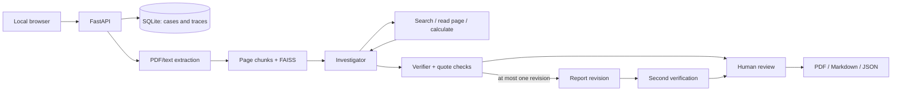

# CaseTrace

**Evidence-linked document investigation with an investigator, a verifier and human review.**

Author: **MAROC Abdelhakim Fouad** · October 2026

CaseTrace turns a small dossier of text-based PDFs into a structured consistency report. An investigator can retrieve passages, open a source page and calculate amounts or date differences. A separate verifier challenges the findings against the original pages. Every final finding remains inspectable and requires human judgment.

The demonstration uses **fictional insurance dossiers**. It is a software/research prototype, not a fraud detector or an automated claims decision system.

## What works

- Local web workspace: upload documents, select dossiers, inspect pages and quoted passages.
- FastAPI API, SQLite persistence, background investigation and cancellation.
- LangGraph workflow with **two LLM roles**, explicit allowlisted tool actions and at most one semantic revision.
- Page-preserving RAG with FAISS. Default vectors are **local lexical vectors**, not neural embeddings. Optional Gemini semantic embeddings are implemented separately.
- Pydantic report validation, exact-quote checks and per-finding verifier assessments.
- Persisted agent actions, structured responses, model/token usage and human review notes.
- JSON, Markdown and PDF exports.
- Three modes: agent workflow, single-pass RAG baseline and an explicitly labelled deterministic offline template demo.
- Nine synthetic PDFs, expected categories, eight retrieval queries, executable tests and saved real Gemini outputs.

## Run locally

Python **3.12** is the tested version. No Node build step is needed.

For an immediate **recorded demonstration**, open `CaseTrace_Demo.html` in a normal browser. It is self-contained, includes real saved outputs and source documents, and makes no model calls. The banner explicitly distinguishes it from the live application. Failed current attempts remain visible; an available older success is labelled historical in its trace.

### Windows / PowerShell

```powershell
python -m venv .venv
.venv\Scripts\python.exe -m pip install -r requirements.txt
Copy-Item .env.example .env
```

Edit `.env` locally and fill `GEMINI_API_KEY`. **Credentials belong only in the ignored local configuration file.** If `.env` already exists, keep it rather than copying over it.

```powershell
.venv\Scripts\python.exe run.py
```

Open **http://127.0.0.1:8768**. On subsequent launches, double-click `start.cmd`.

To preload the saved evaluation runs into the live workspace without making API calls:

```powershell
.venv\Scripts\python.exe scripts/import_recorded_runs.py
```

### Linux / macOS

```bash
python3 -m venv .venv
source .venv/bin/activate
pip install -r requirements.txt
cp .env.example .env
python run.py
```

Click **Load synthetic cases**, choose a dossier, then choose a mode. Live calls require the consent checkbox. The key stays on the backend.

Without a key, use **Offline template demo**. This mode only checks explicit `field: value` patterns and does not run LLM agents or answer arbitrary questions.

## Model options

### Gemini API — exercised with real calls

```dotenv
CASETRACE_PROVIDER=gemini
CASETRACE_MODEL=gemini-2.5-flash
GEMINI_API_KEY=your_local_key
CASETRACE_EMBEDDINGS=local
CASETRACE_MAX_CALLS=8
```

The application does not activate billing. An API key's own billing and quota settings govern usage; this application cannot guarantee that any arbitrary key has a free tier. HTTP 429 ends the run with a recorded error. It does not retry indefinitely or switch providers. Default token/call limits bound a run, not a monetary account budget.

To try semantic retrieval, set `CASETRACE_EMBEDDINGS=gemini`. Document chunks and queries then go to `gemini-embedding-001`. Embedding requests are additional to the displayed chat-model call counter, are batched and are not included in chat-token totals. Local lexical retrieval keeps indexing on the machine. See the evaluation artifact for which configuration was actually measured.

### Local OpenAI-compatible endpoint — configurable, not claimed as locally tested

With an installed local server such as Ollama and a downloaded compatible model:

```dotenv
CASETRACE_PROVIDER=compatible
CASETRACE_BASE_URL=http://127.0.0.1:11434/v1
CASETRACE_MODEL=your_installed_model_name
CASETRACE_API_KEY=
CASETRACE_EMBEDDINGS=local
```

The server/model must support chat completions, JSON output and JSON-schema response formatting. Hardware, speed, memory use and tool reliability depend on the selected model. Restart CaseTrace after changing `.env`.

## Verification and saved results

```powershell
.venv\Scripts\python.exe scripts/test.py --junitxml=artifacts/tests.xml
.venv\Scripts\python.exe scripts/evaluate.py
```

The test runner preloads FAISS before pytest output capture, addressing a native DLL initialization issue encountered with this Windows/Anaconda environment. The tests use deterministic fakes rather than paid model calls.

To run actual Gemini experiments:

```powershell
.venv\Scripts\python.exe scripts/evaluate.py --live
# Or one bounded experiment:
.venv\Scripts\python.exe scripts/evaluate.py --live --case 02_conflicting --mode agents
```

**Live evaluation sends only the bundled synthetic cases.** Results, failures, traces, document hashes, token counts and elapsed times are written to [`artifacts/evaluation.json`](artifacts/evaluation.json). Current experiments are in `runs`; previous attempts retained since the history mechanism was added are in `development_history`. Initial exploratory development attempts were not all retained. The dataset was used during development: this is a smoke benchmark, **not a held-out scientific evaluation**.

- [`docs/RESULTS.md`](docs/RESULTS.md): measured summary, generated from the artifact.
- [`docs/TECHNICAL_REPORT.md`](docs/TECHNICAL_REPORT.md): architecture, experimental protocol and limitations.
- [`docs/DEMO.md`](docs/DEMO.md): demonstration workflow and design rationale.
- [`docs/DEMARRAGE_FR.md`](docs/DEMARRAGE_FR.md): French getting-started guide.

On the paired synthetic example, the verifier adds an audit step and consumes additional calls and tokens without improving category coverage. The recorded results do not establish an accuracy advantage over single-pass RAG.

## Architecture



The tool protocol is **application-level JSON actions**, not a claim that native provider function-calling APIs are used. Roles are sequential instances of the same configured model, not independently trained systems. The graph performs at most three investigator tool actions. A model-call budget additionally bounds schema repair and verification.

## Repository map

```text
casetrace/          API, graph, model adapter, schemas, storage, retrieval
static/             Browser UI (no external frontend dependencies)
demo_cases/         Nine reproducible fictional PDFs + expected labels
scripts/            Dataset generation, evaluation, tests, packaging
tests/              Unit and API integration tests
artifacts/          Measured results and verification outputs
docs/               Technical report, results and demonstration guide
data/               Local user uploads and SQLite (ignored)
.env                Local secret configuration (ignored)
```

`requirements.txt` specifies compatible ranges. `requirements-lock.txt` records the exact packages in the tested Python environment. The lock is an environment snapshot; Docker/Linux compatibility is not established merely by this Windows snapshot.

## Docker and CI

`docker compose up --build` is provided as an alternative after configuring `.env`. The exposed port is bound to localhost. The image recipe and CI workflow are supplied; see `docs/RESULTS.md` for whether they were actually executed. No public deployment or CI pass is implied by including these files.

## Limits and security boundaries

- Local single-user prototype: no authentication, tenancy, encryption at rest, OCR or production job queue. Do not expose it publicly as-is.
- Stored reports and events include source excerpts. API consent covers transmission to the configured model. Use synthetic/public data until appropriate handling requirements are established.
- Document prompts are treated as untrusted input. Tools do not execute shell commands, SQL from the model, arbitrary network requests or document instructions. These measures reduce exposure; they do not prove immunity to prompt injection.
- Quote matching checks normalized substring presence, **not whether a conclusion follows logically**. A verifier can agree with an incorrect interpretation; human review remains necessary.
- Cancellation prevents subsequent steps but cannot retract an in-flight API request. Restarted queued/running jobs are marked interrupted.
- At most 12 documents per dossier, 5 MiB per file, 40 pages per PDF and 500,000 extracted characters per dossier. These are application limits, not a hardened hostile-upload security boundary.
- No PDF text means no analysis: scanned images require separate OCR.

## References

- [Gemini OpenAI-compatible API and structured output](https://ai.google.dev/gemini-api/docs/openai)
- [LangGraph documentation](https://docs.langchain.com/oss/python/langgraph/overview)
- [FAISS](https://github.com/facebookresearch/faiss)
- [FastAPI](https://fastapi.tiangolo.com/)
